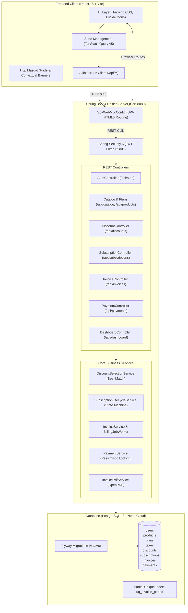
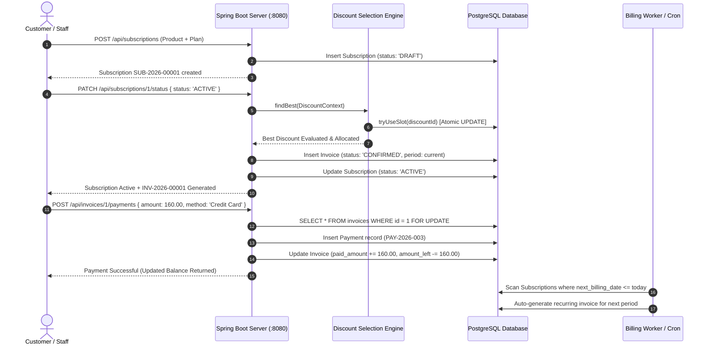

# 🐇 Brightloop — Enterprise Subscription Management & Recurring Billing Platform

[](https://openjdk.org/)
[](https://spring.io/projects/spring-boot)
[](https://react.dev/)
[](https://vitejs.dev/)
[](https://tailwindcss.com/)
[](https://neon.tech/)
[](https://flywaydb.org/)
[](#)

> **Brightloop** is a full-stack, enterprise-grade Subscription Management & Recurring Billing Platform. Built with **Spring Boot 4 (Java 25)** and **React 18 + Vite**, it delivers financial-grade precision, double-billing prevention, concurrent slot-safe discount allocation, atomic payment ledgers, automated invoice generation with PDF exports, multi-role RBAC, and an interactive, route-aware mascot guide named **Hop**.

---

## 🌟 What Makes This Project Special?

This project goes far beyond a generic CRUD app. It was designed from the ground up to solve the real, complex distributed systems problems that plague billing and financial software:

### 1. 🧮 Zero Floating-Point Arithmetic (Financial Precision Engine)
- **Problem**: IEEE 754 floating-point operations (`float`, `double`) introduce catastrophic rounding anomalies (e.g., `0.1 + 0.2 = 0.30000000000000004`), leading to balance drift and tax calculation errors.
- **Solution**: The entire system strictly enforces **`BigDecimal`** scaled to 2 decimal places with `RoundingMode.HALF_UP`. Database tables back this with `NUMERIC(14,2)` for monetary sums and `NUMERIC(5,2)` for tax percentages. Floating-point numbers are prohibited at every layer.

### 2. 🛡️ Database-Level Double-Billing Prevention
- **Problem**: Distributed network retries, race conditions, or duplicate cron execution can trigger multiple invoices for the exact same billing cycle, charging customers twice.
- **Solution**: A PostgreSQL partial unique index:
  ```sql
  CREATE UNIQUE INDEX uq_invoice_period
  ON invoices (subscription_id, period_start)
  WHERE status <> 'CANCELLED';
  ```
  Even under heavy concurrency or accidental repeated job runs, duplicate invoices are physically impossible at the database engine level.

### 3. 🎯 Greedy Best-Discount Selection Algorithm (No Stacking)
- **Problem**: Customers often qualify for multiple promotional codes, seasonal sales, and volume tier discounts. Stacking can accidentally reduce order value to zero.
- **Solution**: An algorithmic evaluation engine ([`DiscountSelectionService`](file:///C:/Users/suryam%20singh/Desktop/subs/Subscription-Management-System/Backend/src/main/java/com/brightloop/subscription_management_system/billing/service/DiscountSelectionService.java)) calculates prospective savings across eligible line items and whole orders, automatically selecting the **single best discount** maximizing customer savings.
- **Proportional Allocation with Residual Penny Preservation**: The discount is proportionally distributed across eligible invoice lines. Any residual cent created by non-divisible math is systematically assigned to the final item so that line discounts sum *exactly* to the header discount.

### 4. ⚡ Atomic Slot Quota Deduction & Automatic Refund
- **Problem**: Flash sales with limited usage limits (e.g. "First 50 subscribers get 30% off") suffer from race conditions in typical read-modify-write patterns.
- **Solution**: Concurrency-safe atomic updates:
  ```sql
  UPDATE discounts
  SET used_count = used_count + 1
  WHERE id = :id AND used_count < usage_limit;
  ```
  If zero rows are updated, the discount is exhausted. If an unpaid invoice is subsequently cancelled, the slot is restored (`revertSlot`).

### 5. 🔒 Pessimistic Ledger Locking & Overpayment Protection
- **Problem**: Concurrent payment submissions (e.g., customer rapid-clicks "Pay", or webhook and manual cashier fire simultaneously) can result in overpayments or corrupted ledger balances.
- **Solution**: Payment recording executes inside a database transaction that acquires a pessimistic write lock (`SELECT ... FOR UPDATE`) on the target invoice.
- If payment exceeds `amountLeft`, the request is rejected with `400 Bad Request`.
- Partial payments are supported; once cumulative payments equal `total`, the invoice automatically flips to `PAID`.

### 6. 🥷 Zero-Trust Security & Tenant-Grade Data Isolation
- **Problem**: Insecure Direct Object Reference (IDOR) vulnerabilities where a customer tampers with `customerId` or `subscriptionId` in URL or body parameters.
- **Solution**: Customer IDs are extracted strictly from the cryptographically verified JWT principal in the security context.
- **Anti-Enumeration 404s**: If a customer requests a subscription or invoice that does not belong to them, the system responds with `404 Not Found` rather than `403 Forbidden`, preventing resource existence probing.

### 7. 📦 Unified Self-Contained Deployment (Port 8080)
- **Problem**: Typical modern apps require running separate frontend Node.js dev servers and backend Java servers, causing CORS friction, multi-port complexity, and tricky reverse proxy configurations.
- **Solution**: The production React Vite build is embedded directly into Spring Boot (`src/main/resources/static/`). A specialized [`SpaWebMvcConfig`](file:///C:/Users/suryam%20singh/Desktop/subs/Subscription-Management-System/Backend/src/main/java/com/brightloop/subscription_management_system/config/SpaWebMvcConfig.java) with `PathResourceResolver` routes all client-side SPA paths (`/login`, `/app/**`, `/portal/**`) seamlessly to `index.html`, while serving REST endpoints under `/api/**`.

### 8. 🐰 Meet "Hop" — Intelligent Interactive Billing Mascot
- **Problem**: Enterprise subscription software is notorious for cluttered, intimidating dashboards where users don't understand quotation statuses or invoice cycles.
- **Solution**: **Hop**, an animated, route-aware billing guide embedded directly in the frontend:
  - **Dynamic Mascot Banner**: Delivers proactive advice on each page (e.g., highlighting overdue invoices on the dashboard, explaining how quotation templates work in the subscription builder).
  - **Mascot Guide Floating Widget**: Collapsible companion anchored at the bottom-right for instant tips and shortcuts.
  - **Animated Topology Backdrop**: Interactive particle topography canvas rendered via Vanta.js & p5.js.
  - **Instant 1-Click Role Switcher**: Topbar switcher allows instant switching between Admin, Staff, and Customer without having to log out.

### 9. 📄 Native PDF Invoice Generation (OpenPDF)
- Generates pixel-perfect, printer-friendly PDF invoices dynamically via `/api/invoices/{id}/pdf`.
- Features complete corporate branding, invoice metadata, customer billing details, line-item pricing tables, tax breakdowns, discount line items, and payment history.

### 10. 🔄 Automated Billing Cycle Job & Catch-Up Engine
- Background recurring cron worker (`0 0 2 * * ?`): Scans active subscriptions where `next_billing_date <= today`.
- Generates invoices for elapsed periods, advances `next_billing_date`, and supports retrospective catch-up for periods missed during downtime.

---

## 🏛️ System Architecture



---

## 🔄 End-to-End Business Flow



---

## 💻 Tech Stack & Engineering Decisions

| Layer | Component | Version | Rationale |
|---|---|---|---|
| **Language** | Java | **25 LTS** | Latest language enhancements, records, pattern matching, performance |
| **Framework** | Spring Boot | **4.1.2** | Enterprise standard for high-throughput, secure REST microservices |
| **Persistence** | Spring Data JPA / Hibernate | 7.4.x | Optimized query generation, open-in-view management, entity relationships |
| **Database** | PostgreSQL (Neon Cloud) | 18.6 | ACID compliance, partial indexes, native JSON support, connection pooling |
| **Migrations** | Flyway | 12.4.x | Schema versioning from V1 to V6 for reproducible, audit-ready migrations |
| **Security** | Spring Security 6 + JJWT | 0.12.6 | Stateless HMAC-SHA384 JWT tokens, method-level `@PreAuthorize` guards |
| **PDF Engine** | OpenPDF | 2.0.3 | Native PDF generation without external headless browser dependencies |
| **Frontend Framework** | React + Vite | 18.3 / 5.4 | Sub-second Hot Module Replacement, optimized bundle packaging |
| **State & Cache** | TanStack Query | v5 | Zero-latency query caching, automatic invalidation, and refetching |
| **UI & Animations** | Tailwind CSS + Lucide | 3.4 / 0.4x | Responsive layouts, dark/light pastel theme, crisp vector icons |
| **Background FX** | Vanta.js + p5.js | Latest | Interactive 3D topology canvas creating a signature aesthetic |

---

## 🗄️ Database Architecture & Migrations

The database is version-controlled via Flyway migrations:

- **`V1__create_users_table.sql`**: Core user authentication table with roles (`ADMIN`, `STAFF`, `CUSTOMER`), hashed passwords (BCrypt 12 rounds), and company metadata.
- **`V2__create_catalog_tables.sql`**: Product definitions, product variants (attribute name/value + delta price), billing plans (Daily, Weekly, Monthly, Yearly + pause/renew/close flags), and tax percentage rules.
- **`V3__create_discount_tables.sql`**: Configurable promotional discount codes, validity windows, type (`PERCENT`, `FIXED`), usage limits, and atomic counters (`used_count`).
- **`V4__create_subscription_tables.sql`**: Quotation templates, subscriptions, subscription lines, and immutable audit log (`subscription_status_history`).
- **`V5__create_billing_tables.sql`**: Invoices, invoice lines with tax and discount subtotals, discount usage tracking, and the partial unique index `uq_invoice_period`.
- **`V6__create_payments_table.sql`**: Financial ledger entries with unique payment tracking numbers, payment method, transaction references, and notes.

---

## 🚀 Getting Started & Local Setup

### Prerequisites
- **Java 21 or 25**: Verify with `java -version`.
- **Node.js 18+ & npm**: Verify with `node -v` and `npm -v`.

### Running the Integrated Application (Production Mode)

The entire application runs unified on **`http://localhost:8080`**:

1. **Build the Frontend (already done and bundled)**:
   ```powershell
   # In Frontend directory
   npm run build
   ```

2. **Copy Static Assets into Backend (already bundled)**:
   ```powershell
   Copy-Item -Path "Frontend\dist\*" -Destination "Backend\src\main\resources\static" -Recurse -Force
   ```

3. **Start the Unified Spring Boot Application**:
   ```powershell
   # In Backend directory
   .\mvnw.cmd spring-boot:run
   ```
   *Or launch the pre-compiled JAR:*
   ```powershell
   java -jar target\subscription-management-system-0.0.1-SNAPSHOT.jar
   ```

4. **Open in Browser**:
   Navigate to **[http://localhost:8080](http://localhost:8080)**.

---

## 👥 Demo Accounts (Pre-Seeded)

The database automatically seeds credentials for testing and evaluation:

| Role | Email | Password | Allowed Capabilities |
|---|---|---|---|
| **Admin** | `admin@brightloop.com` | `Password123!` | Full control: Catalog, Staff, Taxes, Discounts, Invoices, Subscriptions |
| **Staff** | `staff@brightloop.com` | `Password123!` | Operations: Subscriptions, Templates, Invoices, Customer Payments |
| **Customer** | `customer@acme.com` | `Password123!` | Self-Service Portal: View own subscriptions, download PDFs, pay invoices |

> 💡 **Pro-Tip**: Use the **"Role Switcher"** in the top bar to swap between roles with one click!

---

## 📡 REST API Reference Guide

All REST endpoints reside under `/api` (or `/api/v1`):

### 1. Authentication (`/api/auth`)
- `POST /api/auth/login`: Authenticate and receive JWT token + user summary.
- `POST /api/auth/register` (or `/api/auth/signup`): Create new customer account.
- `GET /api/auth/me`: Get current authenticated user profile.

### 2. Catalog Management (`/api/products`, `/api/plans`, `/api/taxes`)
- `GET /api/products`: Paged list of products with search and filtering.
- `POST /api/products`: Create a new product.
- `POST /api/products/{id}/variants`: Add variant with price modifier.
- `GET /api/plans`: List billing plans (Daily, Weekly, Monthly, Yearly).
- `GET /api/taxes`: List configured tax percentage rules.

### 3. Quotation Templates (`/api/templates`)
- `GET /api/templates`: List reusable quotation templates.
- `POST /api/templates`: Create quotation template with pre-configured products.
- `DELETE /api/templates/{id}`: Deactivate template.

### 4. Subscriptions (`/api/subscriptions`)
- `GET /api/subscriptions`: Paged list of subscriptions (auto-filtered for customers).
- `GET /api/subscriptions/{id}`: Detailed subscription view with lines.
- `POST /api/subscriptions`: Create subscription directly with lines & plan.
- `PATCH /api/subscriptions/{id}/status`: Transition status (`QUOTATION`, `CONFIRMED`, `ACTIVE`, `PAUSED`, `CLOSED`).
- `GET /api/subscriptions/{id}/activity`: Complete status transition audit trail.

### 5. Invoicing & Ledger (`/api/invoices`)
- `GET /api/invoices`: List invoices with status/date filters.
- `GET /api/invoices/{id}`: View invoice with lines, taxes, discount, balance.
- `GET /api/invoices/{id}/pdf`: Download official OpenPDF invoice document.
- `POST /api/invoices/{id}/payments`: Record partial or full payment.
- `PATCH /api/invoices/{id}/status`: Confirm or cancel invoice.

### 6. Analytics & Telemetry (`/api/dashboard`)
- `GET /api/dashboard/metrics`: Active subscriptions, total revenue collected, outstanding debt, overdue invoice count.
- `GET /api/dashboard/revenue-chart`: Monthly aggregated recurring revenue.
- `GET /api/dashboard/overdue-invoices`: Prioritized aging overdue invoices list.

---

## 🧪 Testing & Verification

Run the comprehensive test suite verifying context loading, Flyway schema, and business rules:

```powershell
# In Backend directory
.\mvnw.cmd test
```

**Results:**
```text
[INFO] Tests run: 15, Failures: 0, Errors: 0, Skipped: 0
[INFO] BUILD SUCCESS
```

---

## 📄 License & Attribution

Developed with pride for **Brightloop Software**. Built with modern software engineering standards to demonstrate enterprise Java and React design patterns.
